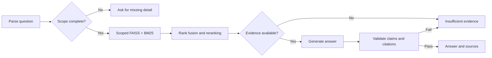

# Policy RAG

A local search application for ten OECD TaxBEN policy descriptions. Ask about taxes
and benefits by country and year, compare rules, and inspect the PDF pages cited in
an answer. Missing country or year details are clarified before retrieval.

## Run

After setup, keep Ollama running and start the server from the repository root:

```sh
.venv/bin/python -m uvicorn app.main:app --host 127.0.0.1 --port 8000
```

Open [http://127.0.0.1:8000](http://127.0.0.1:8000). Leave the terminal open; press
`Ctrl+C` to stop the server. There is no need to repeat setup or evaluation each time.
If port 8000 is already in use, check whether an existing instance is running before
starting another. `GET /health` reports liveness and index availability.

## Setup

Requires Python 3.11 or 3.12 and [Ollama](https://ollama.com/download).

```sh
python3 -m venv .venv
source .venv/bin/activate
python -m pip install uv
uv sync --locked
cp -n .env.example .env
ollama pull gemma4:26b
python -m app.ingestion --download
python -m app.ingestion
```

Start `ollama serve` if the desktop app is not running. The default model uses about
17 GB for weights; a 32 GB Apple Silicon machine leaves room for inference and the
smaller search models. Paths, model names, chunk sizes and retrieval limits are set
in `.env`. `uv.lock` pins dependencies.

Thinking is disabled for predictable response times. Set `POLICY_LLM_THINKING=null`
if the chosen model does not accept Ollama's thinking option.

The first index build downloads `BAAI/bge-small-en-v1.5`; the first search downloads
`cross-encoder/ms-marco-MiniLM-L6-v2`. After caching both, `HF_HUB_OFFLINE=1` keeps
model loading offline. Questions and evidence stay local with the default settings.

## Documents

The collection covers Australia, Canada, Germany, the United Kingdom and the United
States for 2024 and 2025. The manifest in `data/corpus.json` records each document's
source, archive member, page count, SHA-256 and policy-year evidence. Original PDFs
are stored in `data/policies/` and excluded from Git.

| Country | 2024 archive member | 2025 PDF |
| --- | --- | --- |
| Australia | [Australia/Australia_2024.pdf](https://webfs.oecd.org/Els-com/Tax%20Ben/documents%20for%20all%20years/Australia.zip) | [Australia TaxBEN 2025](https://www.oecd.org/content/dam/oecd/en/topics/policy-sub-issues/income-support-redistribution-and-work-incentives/TaxBEN-Australia-latest.pdf) |
| Canada | [Canada/Canada_2024.pdf](https://webfs.oecd.org/Els-com/Tax%20Ben/documents%20for%20all%20years/Canada.zip) | [Canada TaxBEN 2025](https://www.oecd.org/content/dam/oecd/en/topics/policy-sub-issues/income-support-redistribution-and-work-incentives/TaxBEN-Canada-latest.pdf) |
| Germany | [Germany/Germany_2024.pdf](https://webfs.oecd.org/Els-com/Tax%20Ben/documents%20for%20all%20years/Germany.zip) | [Germany TaxBEN 2025](https://www.oecd.org/content/dam/oecd/en/topics/policy-sub-issues/income-support-redistribution-and-work-incentives/TaxBEN-Germany-latest.pdf) |
| United Kingdom | [United_Kingdom/United_Kingdom_2024.pdf](https://webfs.oecd.org/Els-com/Tax%20Ben/documents%20for%20all%20years/United_Kingdom.zip) | [United Kingdom TaxBEN 2025](https://www.oecd.org/content/dam/oecd/en/topics/policy-sub-issues/income-support-redistribution-and-work-incentives/TaxBEN-United_Kingdom-latest.pdf) |
| United States | [United_States/United_States_2024.pdf](https://webfs.oecd.org/Els-com/Tax%20Ben/documents%20for%20all%20years/United_States.zip) | [United States TaxBEN 2025](https://www.oecd.org/content/dam/oecd/en/topics/policy-sub-issues/income-support-redistribution-and-work-incentives/TaxBEN-United_States-latest.pdf) |

Sources come from the [OECD collection](https://www.oecd.org/en/topics/sub-issues/income-support-redistribution-and-work-incentives/how-do-countries-calculate-tax-liabilities-and-social-benefit-entitlements.html).
Policy year is checked inside the PDF, separately from its publication date.
Canada's 2024 document, for example, has a 2025 copyright.

The downloader saves only the requested PDF from each archive. Since OECD's `latest`
URLs can change, ingestion rejects a changed checksum or cover year. Review the
manifest against the archive before replacing a document. To supply files manually,
use the exact filenames in the manifest and skip `--download`.

## Workflow



`app/ingestion.py` verifies PDFs, extracts text with page boundaries and builds a
FAISS index per document. Chunks contain at most 380 tokens with up to 45 tokens of
paragraph overlap. This leaves space for headings within the search models' 512-token
windows. Long text is split at paragraph, line and sentence boundaries before words.

A fingerprint covers PDF bytes, metadata, embedding model and chunk settings.
Unchanged inputs reuse the saved index. Builds publish atomically through
`data/index/CURRENT`, preserving the previous build on failure. Restart after rebuilding.

`app/retrieval.py` selects country/year partitions before dense and BM25 search.
Dense search handles paraphrases; BM25 captures exact names and numerical terms.
Reciprocal rank fusion combines their ranks. Fifteen candidates per method and scope
enter fusion; up to twenty are reranked by a cross-encoder, and at most six reach
the answer model. Every requested scope gets context space. The relevance threshold
is a model logit, not a confidence percentage.

Income-tax queries also select the tax chapter and include the phrase "income tax
rules" to normalize informal wording. Benefit and contribution queries search the
broader document scope. Keyword indexes are rebuilt from eligible chunks in memory;
a larger corpus would benefit from a persistent keyword index and vector metadata filters.

`app/workflow.py` uses LangGraph for parsing, retrieval, generation and validation.
Explicit countries, years and amounts are parsed in Python. SQLite checkpoints retain
questions through clarification and follow-up turns. The model receives the resolved
scope and retrieved evidence. Citation IDs, source scope and numerical values are
checked in Python; a separate call checks semantic support. Failed checks return
insufficient evidence.

A `Decimal` calculation supports annual contributions with the complete rule
`min(annual insurable earnings, ceiling) × rate / 100`. Rates and ceilings must come
from cited evidence; currency and eligibility must be explicit in the question.

`app/main.py` serves the HTML interface, chat endpoint and original PDFs. The source
panel shows excerpts and page links. Retrieval counts and timings remain collapsed
under Details. One model request runs at a time; concurrent requests receive a busy
response. A single OpenMP thread avoids a FAISS/PyTorch crash reproduced on macOS.

## Examples

- "What income tax rules applied in 2025?" followed by "Canada".
- "What employment income tax rules are described for the United Kingdom in 2025?"
- "What changed in Canada's federal income tax treatment between 2024 and 2025?"
- "Compare child benefit eligibility in Canada and Germany in 2025."
- "What support can replace lost earnings after losing a job involuntarily in Canada in 2025?"
- "Who qualifies for Supplemental Nutrition Assistance Program (SNAP) in the United States in 2025?"
- "What are the visa application requirements for Canada in 2025?" — outside this corpus.

## Checks

```sh
.venv/bin/python -m pytest -q
.venv/bin/python -m app.evaluate
.venv/bin/ruff check app tests
.venv/bin/ruff format --check app tests
```

Unit tests use small text fixtures and need no model downloads. `app/evaluation.json`
contains twenty source-checked cases covering all documents, clarification, comparisons,
keyword and semantic retrieval, citations, arithmetic and unsupported questions.
The set was prepared during implementation; it is not an independent human benchmark.

Evaluation uses the real corpus and local models. It reports metadata filtering,
expected-page hits, citation provenance, excerpt consistency and response correctness
in `evaluation-results.json`, and exits nonzero on failure. Use `--retrieval-only`
to skip answer generation, or `--case uk-employment-tax` to run one case. Model checks
can take several minutes; retrieval results alone do not measure answer quality.

## Limits

- Text PDFs only. Image-only pages fail explicitly; OCR is not included. Extracted
  tables retain their text but are not a structured tax-rule database.
- OECD descriptions can use representative regions, such as Ontario. They cannot
  establish an individual's complete tax liability. Calculations are limited to the
  contribution formula above.
- Use explicit countries and years. The parser handles common follow-ups but does
  not resolve every ambiguous location or relative date. Comparisons allow four scopes.
- The same local model generates answers and checks semantic support, so errors can
  correlate. Citations make interpretations traceable; they do not guarantee accuracy.
- Bind to loopback for single-user use. Request limits, origin/host checks, text-only
  rendering and manifest-controlled PDF paths are enforced; there is no authentication.
  SQLite stores conversation text locally. Browser history keeps twenty visible turns.
